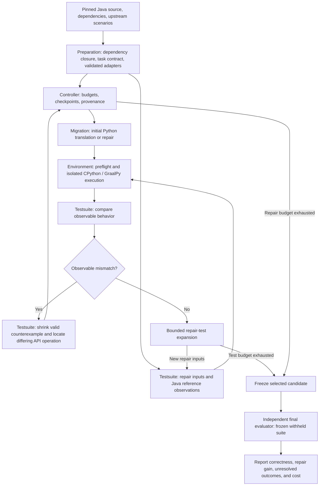

# Literature review and proposed research direction
Reviewed November 13, 2026. Repository checkpoint: 842791a. This is a research/design review, not an implementation change or reproduction of published results.

## Recommendation
Develop and evaluate **counterexample-guided repair for stateful Java-to-Python library slices**. Ask whether source-grounded input generation and compact, localized behavioral feedback improve withheld correctness over ordinary test-feedback repair under comparable budgets.

This is a candidate research direction, not an established novelty claim. Test generation, execution feedback, static analysis, and multi-agent repair all have substantial prior work. A defensible contribution would be a carefully evaluated mechanism and its limits in a clearly defined setting.

## Recommended target architecture

The target is a controller coordinating three roles: Migration, Environment, and Testsuite. Separate evaluators own the final withheld suite. This is the proposed implementation architecture; the generalized contracts, adaptive test expansion, and localized feedback remain to be built.

### Preparation and task contract
Pin source versions and identify a bounded dependency closure. Record constructors, methods, argument/return types, object handles, supported call sequences, exceptions, public observations, and comparison rules in a versioned manifest. Generate adapter skeletons and validate them before admitting a task. Keep unsupported types and manual adapter changes visible. The contract is fixed before comparing candidate translations.

### Migration role
The model receives Java source/dependency context, the task contract, and repair-visible feedback. It produces standalone Python code or a repair. It cannot modify tests, expected outputs, adapters, or the environment policy. The final withheld suite is inaccessible to prompt assembly.

### Environment role
Deterministic services build or verify pinned runtimes, run trusted preflight probes, and execute candidates inside constrained containers. CPython and GraalPy are two execution backends for the same candidate. Known environment faults can invoke bounded allowlisted remediation; unknown failures remain unresolved. Candidate/setup/adapter ambiguity is retained rather than automatically routed to code repair. Infrastructure failures can stop or invalidate evaluation and are recorded separately from semantic mismatches.

### Testsuite role
This role owns repair-visible input generation, Java oracle execution, cross-language observation comparison, counterexample shrinking, and feedback construction. An optional model proposes inputs or semantic-risk hypotheses; deterministic execution establishes observations and mismatch verdicts. Source exceptions are compared under the declared contract. API-call boundaries provide the first localization granularity; internal-state equality is not required.

When all current repair cases pass, a bounded exploration step searches for additional valid repair cases. Any discovered mismatch joins the repair pool and can trigger repair. All checkpoints must be rescored on the same enlarged pool before selection. Shrinking and test expansion have explicit execution budgets. The loop stops on exhausted budgets or completed exploration; passing this pool is not a proof of equivalence.

### Controller and independent final evaluator
The controller records transitions, evidence, model calls, execution costs, and candidate hashes. Selection uses only repair-visible results. A task can end with a successful selected checkpoint, a remaining semantic failure, or an unresolved/infrastructure-invalid outcome.

Before withheld scoring, freeze every experimental condition's selected candidate. The independent evaluator uses the same predeclared contract and validated runtime/adapters, but keeps its suite and observations outside the repair loop. Final mismatches never trigger another repair in that experiment. Report all planned task/trial outcomes and both initial/final results. Existing archived inputs cannot serve as a fresh blind holdout.

### Proposed implementation mapping
- Extend `benchmark.py` with versioned task manifests and dependency discovery.
- Extend `translator.py` with contract-driven context and structured feedback.
- Extend `environment.py` and `isolation.py` for validated stateful adapters.
- Extend `evaluation.py` with operation-sequence observation comparison.
- Add bounded repair-input generation, mismatch-preserving shrinking, and API-boundary localization services.
- Extend `controller.py`, `protocol.py`, and `experiments.py` to preserve adaptive-repair/final-scoring separation and matched experimental conditions.

The proposed core contribution is the measured effect of stronger counterexamples and localized feedback on stateful translation repair. The three roles organize implementation responsibilities; the architecture does not require three independent model agents.

## Accuracy, enforced control, and repository scaling

### What can and cannot be guaranteed
The harness can enforce a fixed acceptance procedure, bounded capabilities, and recorded evidence. Finite tests cannot guarantee equivalence for every input. High accuracy remains an empirical outcome to demonstrate on an independent evaluation set. Report scope, missing coverage, unresolved tasks, and unsupported features alongside pass rates. A model's explanation or confidence is never acceptance evidence.

### Accuracy gates
1. **Qualify the task and oracle.** Pin the source/build, run relevant source tests, verify deterministic observations where required, and validate adapters using independent trusted fixtures. Explicitly declare allowed inputs, exceptions, side effects, and comparison semantics. A working preflight alone does not qualify an oracle.
2. **Check structure before execution.** Parse the candidate; enforce required signatures, exports, allowed paths and dependencies, and declared edit scope. These checks reject interface errors cheaply but do not establish behavioral correctness.
3. **Check behavior.** Run identical valid operation sequences through Java and the Python candidate. Compare return values, declared exceptions, collections, public state observations, and supported side effects. CPython/GraalPy agreement provides runtime compatibility evidence; both may still share the same translation bug.
4. **Challenge apparent successes.** Expand repair-visible tests with boundary cases and stateful sequences; use coverage and mutation results to identify weak testing. The model may propose inputs but may not supply authoritative expected outputs. Apply metamorphic relations only when justified by the source contract.
5. **Repair without losing validated behavior.** Shrink a confirmed mismatch and provide relevant contract/context plus the first differing observable operation. Reevaluate previous successes and any affected integrations. A localized symptom is not automatically the root cause. The strict no-regression policy can reject useful intermediate changes; a necessary coordinated change must be evaluated as a bounded transaction with complete checks.
6. **Validate composition and final outcomes.** Passing component tests does not imply passing repository behavior. Exercise shared state and call chains, then freeze selections and score independent final workloads. Final evaluation is not another source of repair feedback.

### Control belongs to the harness
Treat the LLM as a proposal generator behind a narrow API. A deterministic controller decides what to read, execute, accept, retry, and stop. Instructions in prompts are supplementary; capability restrictions and validation implement the boundary.

- **Read boundary:** provide only the selected dependency context, stable contracts, and repair-visible observations. Repository comments and documentation are untrusted task data, not authority to execute commands or change policy. Keep credentials, final expected outputs, and the final suite outside model context and candidate mounts. Candidates necessarily receive the inputs for the executions being scored, but not the stored expected answers or suite files.
- **Write boundary:** accept structured proposals containing a task identifier, base-checkpoint hash, target files/symbols, and proposed code changes. Validate actual changes against assigned paths and symbols; reject path traversal, stale bases, protected-file edits, and undeclared dependencies. Apply in a disposable candidate workspace. Never directly apply model output to the trusted evaluator or main working tree.
- **Tool boundary:** expose controller-owned operations such as validate_structure, execute_visible, and submit_candidate. If tools are exposed to a model, arguments must be validated against its task capabilities. No unrestricted shell, package installation, build-script execution, test deletion, or policy editing. Environment preparation uses reviewed pinned manifests outside the generated-code execution boundary.
- **Execution boundary:** enforce network, filesystem, privilege, CPU, memory, process, time, and output restrictions at runtime. Keep the Java oracle and trusted comparison process outside the candidate environment. Validate result schemas; fail closed on malformed execution output. AST checks and import allowlists are supplementary and are not a sandbox.
- **Test boundary:** the model can propose typed inputs/call sequences in a constrained schema. Trusted code validates them and computes expected behavior. New test proposals cannot weaken existing assertions, change tolerance, redefine exception mappings, or replace the final evaluator. Contract or adapter changes require a separately reviewed version and fresh qualification.
- **Acceptance boundary:** only the controller can promote a candidate after required checks. Explanations, self-reported test success, or requests to skip checks carry no authority. Hash and archive the exact code, test/contract versions, environment, and results. Hash checks detect changes; read-only boundaries prevent the changes they can prevent.
- **Budget boundary:** cap translation/repair calls, generated tests, shrinking work, runtime consumption, and total spending estimates. Stop on repeated candidates, no progress, or unresolved infrastructure issues. Partial completion remains visible.

Example proposal: repair one assigned parser method against checkpoint H, preserving its signature and using only declared helpers. A response that also edits the comparator, changes expected exceptions, or installs a package is rejected before execution. A well-scoped patch that still disagrees with Java is rejected by behavioral gates. Neither a valid schema nor a safe execution proves semantic correctness.

### Scaling from library slices to larger repositories
Scale by dependency-aware decomposition and incremental validation. Do not send an entire repository to one prompt or treat independent passing methods as a complete migrated project.

1. **Inventory and qualify.** Pin repository/build inputs; identify modules, public APIs, generated code, resource files, native dependencies, and executable test entry points. Record unsupported language features and nondeterministic/external interactions. Admit only components whose contracts and oracle observations can be validated.
2. **Build a conservative dependency graph.** Extract class, method, field, import, and call relationships. Augment static information with exercised calls where useful. Reflection, dynamic loading, callbacks, and dependency injection can leave edges unresolved; preserve uncertainty and require broader integration checks or manual mapping. Observed calls do not prove graph completeness.
3. **Freeze shared interfaces.** Establish a project-wide type/API map and Python skeleton so names, imports, exceptions, overload resolution, collections, and object identity remain consistent. API decisions are shared artifacts, not independent choices made by each translation call.
4. **Schedule coherent units.** Translate leaves before their callers. Group mutually dependent methods/classes into strongly connected components and validate them as a unit. Split oversized units only at explicit validated interfaces; otherwise defer them as unsupported. Parallelize independent units within global budgets, while the controller serializes promotion of shared artifacts.
5. **Assemble bounded context.** Retrieve exact definitions, relevant callees, field declarations, interface contracts, and failure-related source locations using symbol/dependency indexes. Attach source hashes and provenance. Token limits can require explicit deferral; silently omitting a necessary dependency is not a valid scaling strategy. A vector database is optional, not a prerequisite.
6. **Integrate incrementally.** After accepting a unit, run its tests and the affected callers/subsystems. Add cross-module scenarios, object-lifecycle checks, aliasing/mutation cases, resource behavior, and end-to-end workflows. Stubs can support preliminary syntax/interface work, but stub-backed passes cannot count as final behavioral success.
7. **Cache with invalidation.** Key execution reuse by candidate, dependency closure, contract, adapter, suite, comparator, and runtime identities. Translation reuse additionally records model/prompt configuration. Changes invalidate affected dependents; requalification may be required for contract/build changes. Include cold-start and cache-hit costs in reporting.
8. **Freeze and evaluate repository behavior.** Run final integration/workflow tests against the standalone Python result with no fallback to original Java. Report both component-level success and complete project success, the untranslated/unsupported fraction, manual adapter effort, and cost. Components from the same repository are correlated evidence.

The scaling milestones are: one stateful class; a dependency-closed multi-class slice; several slices with shared dependencies; one complete small repository; then larger repositories. Each milestone requires executable integration evidence before making broader claims.

### Existing controls versus proposed extensions
Inspection of `controller.py`, `backends.py`, and `isolation.py` confirms existing structured response parsing, live-code container requirements, constrained execution, protected-file hashes, repair/no-progress limits, no-regression checkpoint selection, and selection before withheld scoring. These controls are valuable but currently operate on the narrow single-module pilot contract.

General scoped multi-file patches, symbol-level write enforcement, dependency graph scheduling, stateful adapters, adaptive repair tests, counterexample minimization, affected-integration checks, and repository-level caching are proposed extensions. This review does not establish that the current harness already implements those capabilities or that any target accuracy has been reached.

## What we already have
The repository contains isolated CPython/GraalPy execution, a Java reference oracle, frozen suites, no-regression selection, paired trials, model adapters, and budget/accounting support. These are useful foundations.

The current contract accepts string inputs or null and returns a finite number; it handles a narrow exception mapping. The fixed task list contains three string algorithms. Feedback sends at most six failures per runtime, without automatic counterexample minimization or execution localization. Source context is assembled from a static file list. The committed live study covers three successful initial Levenshtein translations, with no repair benefit measured.

Evidence: [translation contract](knowledge/translation_contract.md), [benchmark](migration_lab/benchmark.py), [translator](migration_lab/translator.py), [evaluator](migration_lab/evaluation.py), [protocol](migration_lab/protocol.py), [recorded results](EXPERIMENT_RESULTS.md). Code inspected; experiments were not rerun.

## Three additions to prioritize

### 1. A general behavioral contract for stateful library slices
Replace the string-only interface with a versioned task manifest and language-neutral operation sequence:
construct object; call method; retain returned object handle; call another method; observe selected public state and outputs.

Define types, overload mappings, null behavior, exceptions, ordered/unordered collections, integer widths, floating tolerances, and observable side effects per task. Do not equate different internal representations by raw object dumps. For CLI tasks, compare parse results, option values, remaining arguments, and declared exception behavior.

Use a Java parser to collect signatures and a bounded dependency closure. Generate adapter skeletons from the manifest, then validate them against trusted fixtures and source tests. Explicitly record manual adapter work and unsupported types. This supports selected slices; it does not amount to automatic migration of arbitrary repositories or automatic reuse of every JUnit test.

Acceptance gate: at least one constructor/multiple-call scenario works across Java, CPython, and GraalPy, with known faulty translations rejected and no dependence on Java from the target implementation.

### 2. Source-grounded test expansion with measured adequacy
Combine relevant upstream test scenarios, fixed semantic strata, and generated operation sequences. Use an LLM only to propose inputs or suspected failure conditions; obtain expected behavior from Java execution. Preserve contract-valid exception cases rather than filtering every source exception as an invalid input.

Measure source branch coverage and mutation detection. Mutants assess evaluator strength; do not count their repair as natural live-model repair success. Track equivalent or invalid mutants and limitations of the mutation denominator.

Create disjoint development/repair and final evaluation pools with recorded seeds and exact-input overlap checks. The existing suites should be audited for overlapping fixed cases before describing every withheld case as unseen. New counterexamples may enter only the repair pool. Freeze the independent final suite and candidate selections before scoring. Hidden inputs and outputs must never enter prompts, diagnostic traces, or adaptive test selection.

Acceptance gate: the expanded repair suite detects additional real candidate discrepancies compared with the existing fixed suite at a recorded execution cost. Independently evaluate all final candidates on the same withheld suite.

### 3. Minimized counterexamples and localized repair feedback
Shrink a failing input or operation sequence while preserving its validity and the observed mismatch. Return the shortest mismatch-preserving example found within a fixed budget, without claiming a globally minimal input.

Provide source/target outputs, declared exception comparison, the earliest differing observable operation, relevant API/type contracts, and a bounded source dependency slice. This is more actionable than an arbitrary first-six-failures list.

Begin at API boundaries, where mappings are defined by the manifest. Internal variable/CFG alignment is a later experiment: correct programs can have different state representations, so internal differences are debugging hints rather than correctness verdicts. Verify any instrumentation against uninstrumented behavior.

Acceptance gate: localized feedback improves withheld repair outcomes or reduces cost versus the same counterexamples without localization. Include localization failures and regressions.

## Role of environment diagnosis
Keep the reference and fixed healthy target environment as the primary translation experiment. Preflight can identify known setup failures; it cannot prove the evaluator or adapter is correct.

Separately test diagnosis across realistic, justified fault categories: missing declared dependencies, incompatible supported runtime versions, adapter entry-point errors, filesystem permissions, and resource-limit failures. Not every timeout or import error is an environment bug. Use trusted probes and fixed-candidate replay; retain ambiguous outcomes.

Environment corrections must not modify the candidate, oracle, tests, or comparator. Report natural failures separately from injected faults, diagnosis accuracy on reviewed labels, recoveries, unsuccessful recoveries, and resource cost. A successful cache-path correction is evidence for that rule only.

## Proposed experimental design
These quantities are planning targets, not power calculations or completed results.

First qualify approximately 10 development tasks to validate adapters and estimate resource costs. Then freeze a larger evaluation set, initially targeting 30-50 dependency-closed tasks across at least three projects or clearly separate library families. Include methods and stateful classes, ordinary cases and semantic boundaries, with deterministic inclusion rules independent of model success. If coverage or budget forces a smaller set, narrow the claim.

Use two accessible model configurations if feasible and three independent initial generations per task/model. Match the initial candidate across repair ablations. Keep the same source context, inference configuration, maximum repair calls, and total token/compute accounting. Charge diagnosis and test-generation calls to the relevant condition.

Suggested conditions:
- A: one-shot translation.
- B: current fixed-test execution-feedback repair.
- C: B plus source-grounded repair-test expansion.
- D: C plus mismatch-preserving shrinking and localized behavioral feedback.
- E: UniTrans adaptation or artifact run on compatible tasks, documented separately. It changes initial prompting, so do not pretend it shares the same initial candidate as B-D.

For D, a no-localization ablation must receive the same discovered counterexamples as D. If shrinking and localization are bundled initially, only claim a bundle effect; separate them in a follow-up if resources allow. Consider an equal-budget resampling control to check whether gains merely come from additional model calls.

Report per-task all-tests-pass accuracy on the final suite; repair success among initially failing candidates; regressions; unresolved/setup-invalid outcomes; new bugs exposed by test expansion; model calls/tokens; validation CPU time; and elapsed time. Distinguish operational completion from semantic correctness. Give both counts and denominators.

Report task-paired differences and uncertainty at the task/project level, accounting for shared source projects and repeated trials. Test cases and dual-runtime executions are not independent translation samples. Three project clusters are too few for strong population-level claims; keep uncertainty and scope limitations explicit.

Optional after correctness: runtime and peak memory on stress workloads, with startup/warm-up measured separately and within-runtime trusted reference comparisons. Do not allow performance tuning to change the frozen correctness contract.

## How this addresses the professor
- Test selection: documented behavioral categories, provenance, coverage, mutation checks, and split policy replace an unexplained '26'.
- Testsuite and glue: publish the manifest, adapters, and one end-to-end operation-sequence example; state precisely which upstream scenarios are reused.
- Evaluation size: multiple projects, stateful tasks, and preserved unsuccessful trials address the ceiling effect and narrow pilot.
- Metrics: task/trial denominators and repair-only success are explicit.
- Environment repair: separate reliability study avoids using injected setup failures as translation evidence.
- Integrity: keep hashes, immutable source/evaluation artifacts, and recorded invalidation events.

## Implementation order and stop conditions
1. Qualify tasks and build the generalized contract/adapters. Stop expansion when adapter correctness is unresolved.
2. Establish one-shot and current-repair results on the development set. Diagnose ceiling effects without selecting final tasks solely because a model failed.
3. Add test expansion and shrinking; measure extra bugs found and cost.
4. Add API-boundary localization only if failures are difficult to repair and the observations are trustworthy.
5. Freeze the evaluation protocol, run matched conditions, analyze failures, and revise the report around measured evidence.

Defer model training, a general autonomous environment planner, a large vector database, full CFG alignment, multiple translation directions, and performance optimization until the core study works.

## Additional close comparator: AlphaTrans
[AlphaTrans](https://doi.org/10.1145/3729379) already combines program decomposition, dependency context, skeleton construction, and GraalVM-based in-isolation validation for Java-to-Python. It is especially relevant because it is already part of this project's background. Generalized adapters and dependency analysis are necessary engineering, not novelty claims on their own. Compare the proposed testing/feedback mechanism to this prior work before claiming originality.

## Review scope and version cautions
All 18 supplied titles were checked against primary publication/manuscript pages. Depth varies and is recorded below. This is a focused methods review, not a claim to have reproduced results or exhaustively audited every paper.

The RepoTransBench journal PDF could not be fetched; its review uses the journal abstract and official artifact documentation. The TransCoder PDF fetch timed out; its overview uses the proceedings abstract. The remaining links provided accessible manuscripts or full article text, with priority given to methods and evaluation relevant to our project.

Do not compare headline percentages across papers: task units, models, budgets, language directions, oracle/test strength, and versions differ. No claim of a novel gap is established solely by this list.

## Paper-by-paper reading map
### 1. CodeTransBenchmark
Priority: Supporting. Group: Recent. Review depth: Full-text method and evaluation sections.

Finding: A reusable translation, output extraction, execution, error classification, and feedback-repair pipeline. Evaluation covers eight models, three datasets, and 12 language pairs.

Application to this project: Use its error categories and transparent computational-accuracy reporting as an evaluation reference.

Limit: Its tasks are function/snippet scale; repair results are limited to the studied model family. Generic iterative repair is already prior work.

[Primary source](https://link.springer.com/article/10.1007/s10664-026-10968-3)

### 2. A Survey of Code-to-Code Translation
Priority: Background. Group: Recent. Review depth: Full-text taxonomy and evaluation sections.

Finding: Organizes translation approaches, benchmark granularity, and evidence from textual similarity through execution and stronger validation.

Application to this project: Use to structure related work and distinguish model training, inference workflows, benchmarks, and validation.

Limit: A survey supplies a map of evidence, not an experimental baseline or evidence that our particular combination works.

[Primary source](https://www.mdpi.com/1999-4893/19/10/857)

### 3. A Direction-Aware Study
Priority: Supporting. Group: Recent. Review depth: Paper setup and validity sections.

Finding: Studies 56 ordered translation directions using the same 100 problems across eight languages.

Application to this project: Keep Java-to-Python results explicit. If adding another direction, reuse matched problems and report it separately.

Limit: Online-judge tasks do not establish repository migration performance. Its preliminary scope does not justify universal language rankings.

[Primary source](https://drops.dagstuhl.de/entities/document/10.4230/LIPIcs.ESEM.2026.63)

### 4. Problem-Aligned Multilingual Generation and Translation / MciBench
Priority: Supporting. Group: Recent. Review depth: Paper benchmark and experimental-design sections.

Finding: Aligns programming problems across languages and records correctness, sampling, runtime, and memory. Translation is a complementary study on 100 problems, not the entire 1,489-problem generation study.

Application to this project: Match task identities, source versions, and candidate budgets across experimental conditions.

Limit: Do not mix generation results with translation results, or assume passing the checker proves full equivalence.

[Primary source](https://drops.dagstuhl.de/entities/document/10.4230/LIPIcs.ESEM.2026.25)

### 5. An Extensive Empirical Study on Code Translation Technique(s)
Priority: Priority. Group: Recent. Review depth: Full-text class-level results and threats.

Finding: Compares methods and classes; class translation exposes interface, binding, and cross-method failures that compilation alone misses.

Application to this project: Add stateful classes and explicit type/signature contracts; record interface failures separately from behavioral mismatches.

Limit: The arXiv abstract title uses singular 'Technique'; the manuscript uses 'Techniques'. It is a preprint. Published aggregate scores are not comparable to our pilot.

[Primary source](https://arxiv.org/html/2608.20776v1)

### 6. MatchFixAgent
Priority: Priority. Group: Recent. Review depth: Full-text architecture, validation, and test-generation sections; venue verified.

Finding: Analyzes control/data flow, I/O, APIs, exceptions, and specifications, then generates executable tests and repair attempts before producing a verdict.

Application to this project: Turn suspected semantic differences into executable counterexamples. Let the Java source determine expected results.

Limit: Its verdict mechanism is not a proof of equivalence. We should retain an explicit inconclusive outcome when execution or input validity is unresolved.

[Primary source](https://arxiv.org/html/2509.16187v3)

### 7. TransAgent
Priority: Priority. Group: Recent. Review depth: Paper block-alignment and semantic-repair sections.

Finding: Aligns source and target control-flow blocks and compares recorded runtime values to localize a discrepancy before patching.

Application to this project: Start with observable API-call and state checkpoints, then test whether localized feedback improves repair over input/output feedback.

Limit: Full cross-language block alignment is substantial engineering. Different correct implementations need not have matching internal states; the first observed difference is not automatically the root cause.

[Primary source](https://chenzhenpeng18.github.io/papers/FSE26_TransAgent.pdf)

### 8. TRACE
Priority: Later. Group: Recent. Review depth: Paper benchmark construction and publisher abstract.

Finding: Adds stress tests and efficiency references to 1,000 tasks across C++, Java, and Python; correct small-input behavior can hide poor scaling.

Application to this project: After correctness, measure candidate runtime and memory under controlled warm-up and repeated workloads.

Limit: Do not compare total Docker/JVM startup time as algorithm efficiency. Prefer within-runtime comparisons to a trusted target implementation; runtime-to-runtime ratios need explicit caveats.

[Primary source](https://aclanthology.org/2026.acl-long.140/)

### 9. Beyond Translation Accuracy: Addressing False Failures
Priority: Priority. Group: Recent. Review depth: Full-text inspection protocol and failure categories.

Finding: Shows how evaluation configuration, linking, timeouts, and test conversion can falsely reject translations; inspection keeps candidate code unchanged.

Application to this project: Separate evaluator/setup, adapter, candidate, and ambiguous failures. Test a fixed candidate before and after a justified configuration correction.

Limit: Supports reliable evaluation, not a general claim that an environment-repair agent improves translation. Some examples concern compiled languages rather than our Python target.

[Primary source](https://arxiv.org/html/2605.02195v3)

### 10. RepoTransBench
Priority: Priority. Group: Recent. Review depth: Journal abstract and official artifact documentation; full journal PDF fetch failed.

Finding: The journal version reports 1,897 repository translation samples across 13 pairs with executable tests and RepoTransAgent.

Application to this project: Borrow reproducible task manifests and repository-level reporting; audit a Java-to-Python subset for feasibility.

Limit: Do not mix the older preprint's dataset/results with the expanded journal version. A dependency-closed library slice is not an entire migrated repository.

[Primary source](https://research.monash.edu/en/publications/repotransbench-a-real-world-multilingual-benchmark-for-repository/)

### 11. TransCoder
Priority: Background. Group: Established. Review depth: Proceedings abstract; PDF fetch timed out.

Finding: Learns translation from monolingual code and evaluates C++, Java, and Python functions using executable tests.

Application to this project: Explain the move from learned translation models to inference-time validation and repair.

Limit: Training a new translator is a different project from improving our existing inference pipeline.

[Primary source](https://proceedings.neurips.cc/paper_files/paper/2020/hash/ed23fbf18c2cd35f8c7f8de44f85c08d-Abstract.html)

### 12. TransCoder-ST
Priority: Priority. Group: Established. Review depth: Full-text automated testing and mutation-testing sections.

Finding: Uses automated Java tests to filter pseudo-parallel translations for self-training; EvoSuite targets coverage and mutation criteria.

Application to this project: Measure test adequacy with branch coverage and mutation detection, rather than treating a fixed case count as sufficient.

Limit: Its training improvement is not evidence for our repair workflow. Passing generated tests does not establish full semantic equivalence.

[Primary source](https://arxiv.org/html/2110.06773v2)

### 13. Tree-to-tree Neural Networks for Program Translation
Priority: Background. Group: Established. Review depth: Proceedings abstract and manuscript overview.

Finding: Uses tree-structured encoding/decoding and attention to translate program subtrees.

Application to this project: Motivates preserving syntax and structural relationships; use parsers for interfaces and dependencies in our implementation.

Limit: Adding an AST parser to an LLM workflow does not reproduce this neural architecture or constitute a new contribution by itself.

[Primary source](https://proceedings.neurips.cc/paper/2018/hash/d759175de8ea5b1d9a2660e45554894f-Abstract.html)

### 14. Phrase-Based Statistical Translation of Programming Languages
Priority: Background. Group: Established. Review depth: Paper overview and experimental setup.

Finding: Combines phrase-based translation with target grammar and custom rules for C#-to-Java methods.

Application to this project: Historical grounding for combining learned generation with explicit language constraints.

Limit: Compilation and semantic preservation are different outcomes; its setting is not a direct Java-to-Python repair baseline.

[Primary source](https://files.sri.inf.ethz.ch/website/papers/onward14.pdf)

### 15. PLBART
Priority: Background. Group: Established. Review depth: Publisher abstract and manuscript overview.

Finding: A pretrained encoder-decoder using denoising objectives for code and natural-language tasks, including translation.

Application to this project: Include in the pretrained-model background of related work.

Limit: Fine-tuning and evaluating historical models would consume effort without isolating the value of our new feedback mechanism.

[Primary source](https://aclanthology.org/2021.naacl-main.211/)

### 16. CodeT5
Priority: Background. Group: Established. Review depth: Publisher abstract and manuscript overview.

Finding: Uses identifier-aware pretraining in a unified encoder-decoder model.

Application to this project: Motivates attention to identifiers, signatures, and bindings in class translation.

Limit: Identifier-aware model training is not the same as adding symbol checks. Text-similarity metrics should not replace executable behavior checks.

[Primary source](https://aclanthology.org/2021.emnlp-main.685/)

### 17. AVATAR
Priority: Supporting. Group: Established. Review depth: Publisher abstract and manuscript dataset overview.

Finding: Provides Java/Python solutions for 9,515 problems; the original release includes unit tests for only 250 examples.

Application to this project: A candidate source for external Java-to-Python tasks after checking test availability, duplicates, and compatibility.

Limit: Do not describe all 9,515 problems as executable benchmark tasks. Public problems may overlap training data; they do not exercise arbitrary object-state migration.

[Primary source](https://aclanthology.org/2023.findings-acl.143/)

### 18. UniTrans
Priority: Priority. Group: Established. Review depth: Full-text test-generation, augmentation, and repair sections.

Finding: Generates candidate inputs, derives outputs from source execution, uses tests in translation prompts, and repairs failures with execution feedback.

Application to this project: The closest essential baseline: implement a clearly labeled adaptation or run the artifact on compatible tasks with the same model and budgets.

Limit: Our current fixed-input translate/test/repair loop overlaps substantially. A simplified adaptation must not be reported as a faithful reproduction.

[Primary source](https://arxiv.org/html/2404.14646v2)
